<div align="center">

# ⚡ FluxCast

**A blazing-fast developer launcher for Fedora KDE Plasma 6 (Wayland) with a smart clipboard history, snippet vault, and Zero-Knowledge E2EE sync to a native Android companion app.**

*An open-source, local-first, self-hosted productivity suite engineered natively for Linux KDE Plasma and Android.*

[](https://www.rust-lang.org/)
[](https://v2.tauri.app/)
[](https://developer.android.com/compose)
[-1D99F3?logo=kde&logoColor=white)](https://fedoraproject.org/kde/)
[](#-zero-knowledge-e2ee-security)
[](LICENSE)

[Key Features](#-key-features) •
[System Architecture](#-system-architecture) •
[KDE Wayland Integration](#-native-fedora-kde-plasma-6-wayland-integration) •
[Security (E2EE)](#-zero-knowledge-e2ee-security) •
[Getting Started](#-getting-started) •
[Benchmarks](#-measured-benchmarks)

</div>

---

## ✨ Key Features

### 🖥️ Fedora KDE Plasma Desktop App (Rust + Tauri v2)
* **Instant Fuzzy Launcher (<1 ms search):** Powered by Rust's `nucleo-matcher` to search `.desktop` apps, Flatpaks, and local Git repositories (open directly in Dolphin, VS Code, Konsole, or Neovim with `Alt+1..4`).
* **Built-in Offline Dev Utilities:** Instant math evaluator (`=`), `UUID v4/v7` generator (`uuid4`, `uuid7`), `Base64` encoder/decoder (`b64`, `unb64`), Unix timestamp converter (`ts`, `ts now`), base converter (`hex`, `bin`, `dec`), and local `JWT` inspector (`jwt`).
* **Smart Clipboard Manager (`Ctrl+5`):** Persistent local history indexed with **SQLite FTS5**, automatic type classification (`JSON` with pretty-print, `URL`, `code` with language detection, `HEX/RGB color` swatches, `JWT`), pinned favorites (`Ctrl+P`), and plain-text paste (`Shift+Enter`).
* **Developer Snippet Vault (`Ctrl+6`):** Tag-organized code and shell snippets with dynamic template expansion (`{{clipboard}}`, `{{date:YYYY-MM-DD}}`, `{{uuid}}`), frecency ranking, and quick `!alias` triggers (e.g., `!dprune`, `!klog`) directly from the main command bar.
* **Privacy by Default:** Strictly filters clipboard offers carrying `x-kde-passwordManagerHint=secret` so passwords copied from KeePassXC, Bitwarden, 1Password, or KWallet are never stored or synced, plus a built-in **Pause / Incognito Mode** (5 min, 15 min, or manual).

### 📱 Native Android Companion App (Kotlin + Jetpack Compose)
* **Real-Time Bidirectional E2EE Sync:** Copy an API token, command, or URL on Fedora and tap once to copy it on Android — or push items straight to Fedora's system clipboard.
* **Android Share Sheet (`ACTION_SEND`):** Share links or text from Chrome, GitHub, or any Android app directly into your Fedora KDE clipboard.
* **Quick Settings Tile:** Swipe down the Android notification shade and tap **Send to Fedora** without opening the app.
* **Home Screen Widget (Jetpack Glance):** View your latest synced item and most-used snippet directly from the Android home screen.
* **Offline-First & Biometric Lock:** Offline storage and outbox queue via **SQLite + WorkManager**, 1-step QR device pairing (**CameraX + ML Kit**), and **Android Keystore (`AES-256-GCM`) + `BiometricPrompt`** protection.

---

## 🏗️ System Architecture

FluxCast is structured as a unified monorepo where a **single Rust cryptographic and protocol core** powers Fedora KDE, the self-hosted sync relay, and the native Android app (via **Mozilla UniFFI**):

```mermaid
flowchart LR
    subgraph Fedora["Fedora KDE Plasma 6 (Wayland)"]
        UI["Tauri v2 UI (React 19 + Breeze Dark)"]
        Daemon["FluxCast Daemon (Rust)"]
        SQLiteD["SQLite + FTS5 + Outbox"]
        KWallet["Plasma ksecretd / KWallet (oo7)"]
        KWin["KWin ext-data-control-v1"]
        Portal["xdg-desktop-portal-kde (GlobalShortcuts)"]

        KWin -->|Wayland Socket| Daemon
        Portal -->|D-Bus ashpd| Daemon
        UI <-->|Tauri IPC| Daemon
        Daemon <--> SQLiteD
        Daemon <--> KWallet
    end

    subgraph Relay["Sync Relay Server (Self-Hosted / Docker)"]
        Axum["Axum REST + WebSockets (Rust)"]
        PG["PostgreSQL 16 (Ciphertext Blobs Only)"]
        Axum <--> PG
    end

    subgraph Android["Native Android (Kotlin + Jetpack Compose)"]
        Compose["Compose UI (Material You)"]
        Native["Share Sheet + Quick Tile + Glance Widget"]
        UniFFI["FluxCast Rust Core (libfluxcast_uniffi.so)"]
        SQLiteA["Local SQLite + WorkManager Outbox"]
        Keystore["Android Keystore + BiometricPrompt"]

        Native --> Compose
        Compose <--> UniFFI
        Compose <--> SQLiteA
        UniFFI <--> Keystore
    end

    Daemon <-->|"WSS / HTTPS (E2EE)"| Axum
    Compose <-->|"WSS / HTTPS (E2EE)"| Axum
```



---

## 🐧 Native Fedora KDE Plasma 6 (Wayland) Integration

FluxCast is engineered **Wayland-first** around official **KDE Plasma 6 / KWin** standards:

1. **Background Clipboard Monitoring (`ext-data-control-v1`):** Connects directly to KWin's standardized Wayland data-control protocol (with automatic fallback to `zwlr_data_control_manager_v1`), requiring zero shell extensions or XWayland workarounds.
2. **Permission-Gated Global Shortcuts (`xdg-desktop-portal-kde`):** Uses `ashpd` to register `Alt+Space` through `org.freedesktop.portal.GlobalShortcuts` (customizable in *KDE System Settings → Shortcuts*), paired with a `<3 ms` UNIX domain socket CLI (`fluxcast toggle`).
3. **System Credential Storage (`ksecretd` / KWallet):** Stores the 256-bit Master Key inside KDE Plasma's Freedesktop Secret Service (`org.freedesktop.secrets`) via `oo7`.
4. **Password Manager Exclusion:** Fails closed on clipboard offers advertising `x-kde-passwordManagerHint=secret` without ever reading `text/plain`.

See [`docs/kde-wayland.md`](./docs/kde-wayland.md) and [`docs/architecture.md`](./docs/architecture.md) for full details.

---

## 🔐 Zero-Knowledge E2EE Security

The sync relay server is strictly untrusted and only stores opaque encrypted blobs:

* **Key Derivation (KDF):** `Argon2id` (`m = 19 MiB, t = 2, p = 1`, 16-byte random salt) or ephemeral 120-second single-use QR key transfer.
* **Authenticated Encryption (AEAD):** `XChaCha20-Poly1305` with 192-bit random nonces and canonical AAD binding (`fluxcast:v1:<entity_id>:<entity_kind>:<hlc_timestamp>`).
* **Blind Deduplication:** Keyed `HMAC-SHA256` digest computed with a derived subkey so the server cannot mount dictionary attacks on content hashes.
* **Conflict Resolution:** Deterministic **Last-Write-Wins (LWW)** over monotonic **Hybrid Logical Clocks (`Hlc`)**.
* **Single Audited Implementation:** Both Fedora and Android execute `crates/fluxcast-crypto` and `crates/fluxcast-protocol` (compiled into 16 KB page-aligned Android `.so` libraries via `cargo-ndk` + **Mozilla UniFFI**).

See [`docs/crypto-spec.md`](./docs/crypto-spec.md) for the cryptographic wire specification.

---

## 📂 Repository Structure

```text
fluxcast/
├── crates/
│   ├── fluxcast-core/         # SQLite + FTS5, nucleo fuzzy engine, classifier, templates, dev utils
│   ├── fluxcast-crypto/       # Argon2id + XChaCha20-Poly1305 + blind HMAC-SHA256
│   ├── fluxcast-protocol/     # Hybrid Logical Clocks (HLC), QR pairing payloads & sync messages
│   └── fluxcast-uniffi/       # Mozilla UniFFI scaffolding exported to Kotlin
├── apps/
│   ├── desktop/               # Fedora KDE Plasma app (Tauri v2 + React 19 + Wayland daemon)
│   ├── android/               # Native Android app (Kotlin + Jetpack Compose + Glance + Tile)
│   └── sync-server/           # Self-hosted Zero-Knowledge sync server (Axum + WebSockets + PostgreSQL)
├── docs/                      # Architecture ADRs, E2EE cryptographic spec & KDE Wayland guide
├── scripts/                   # Android NDK/UniFFI builder, Fedora systemd installer & verification suite
└── docker-compose.yml         # Self-hosted PostgreSQL 16 + Sync Relay Server deployment
```

---

## 🚀 Getting Started

### Prerequisites (Fedora KDE Plasma)

```bash
sudo dnf install webkit2gtk4.1-devel openssl-devel curl wget file \
  libappindicator-gtk3-devel librsvg2-devel sqlite-devel wl-clipboard \
  pkgconf-pkg-config gcc-c++ rpm-build patchelf fuse fuse-libs podman-compose
```

Install Rust (`stable`), Node.js (`22+`), `pnpm`, and Android targets:

```bash
npm install --global pnpm@10.32.1
rustup target add aarch64-linux-android x86_64-linux-android
cargo install --locked --version 4.1.2 cargo-ndk
pnpm install --frozen-lockfile
```

For Android builds, install JDK 17 (e.g., Temurin 17) and Android SDK/NDK r27 (`platforms;android-35`, `build-tools;34.0.0`, `ndk;27.2.12479018`).

### 1. Run Locally on Fedora KDE

Launch both the local Sync Relay Server (`http://127.0.0.1:8787`) and the native Fedora KDE launcher in one command:

```bash
./scripts/run-local.sh
```

Or install FluxCast permanently into your KDE Application Menu, `~/.local/bin/fluxcast`, and `systemd --user` (`fluxcast.service`):

```bash
./scripts/install-fedora-kde.sh
```

You can also build and install the native Fedora `.rpm` package:

```bash
pnpm --filter @fluxcast/desktop tauri build --bundles rpm
sudo dnf install target/release/bundle/rpm/FluxCast-0.1.0-1.x86_64.rpm
```

### 2. Deploy the Self-Hosted Sync Server (Docker / Podman)

```bash
cp .env.example .env
docker compose up -d
```

The Zero-Knowledge relay listens on `http://localhost:8787/api/v1/health`.

### 3. Build the Native Android App (`.apk`)

```bash
# Compile 16 KB page-aligned Rust .so libraries and generate Kotlin UniFFI bindings
./scripts/build-android-rust.sh

# Run unit tests and assemble the Android APK
./gradlew testDebugUnitTest assembleDebug
```

The installable APK is generated at `apps/android/app/build/outputs/apk/debug/app-debug.apk`.
To pair with Fedora KDE, open the **Sync E2EE (`Ctrl+7`)** tab on Fedora, click **Pair Android via QR**, and scan the 120-second QR code from the Android app (**Settings → Scan QR with CameraX**).

---

## 🧪 Verification & Automated Testing

Run the full verification suite across Rust, UniFFI, Tauri Desktop, headless KWin Wayland E2E, and Android Gradle:

```bash
./scripts/verify-all.sh
```

---

## 📊 Measured Benchmarks (Fedora KDE Plasma 6 Wayland)

| Metric | Target | Measured Result |
| :--- | :---: | :---: |
| **In-Memory Fuzzy Search (5,000 entries, `nucleo-matcher`)** | `< 15 ms` | **p50 `0.44 ms` / p95 `0.87 ms`** |
| **CLI UNIX Socket Toggle (`fluxcast toggle`)** | `< 5 ms` | **p50 `2.22 ms` / p95 `2.87 ms`** |
| **End-to-End IPC Search + GIO `.desktop` Dispatch** | `< 20 ms` | **p50 `14.00 ms` / p95 `18.00 ms`** |
| **Local E2EE Delta Push + Pull Roundtrip** | `< 50 ms` | **p50 `1.74 ms` / p95 `2.28 ms`** |
| **Sync Relay Server Resident RAM (`VmRSS`)** | `< 35 MB` | **`9.45 MB`** |

---

## 📄 License

Licensed under the **MIT License**. See [`LICENSE`](./LICENSE) for details.
