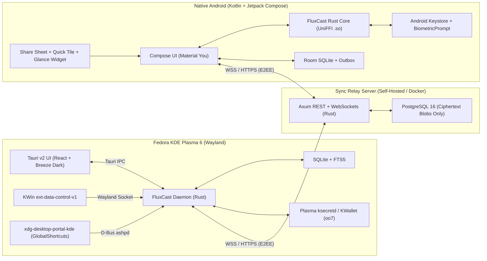

<div align="center">

# ⚡ FluxCast

**A blazing-fast developer launcher for Fedora KDE Plasma (Wayland) with a smart clipboard history, snippet vault, and Zero-Knowledge E2EE sync to a native Android companion app.**

*An open-source, local-first, self-hosted alternative to paid tools like Raycast Pro and Paste — engineered natively for Linux KDE Plasma and Android.*

[](https://www.rust-lang.org/)
[](https://v2.tauri.app/)
[](https://developer.android.com/compose)
[-1D99F3?logo=kde&logoColor=white)](https://fedoraproject.org/kde/)
[](#-zero-knowledge-e2ee-security)
[](LICENSE)

[Features](#-key-features) •
[Architecture](#-system-architecture) •
[KDE Wayland Integration](#-native-fedora-kde-plasma-6-wayland-integration) •
[Security (E2EE)](#-zero-knowledge-e2ee-security) •
[Getting Started](#-getting-started) •
[ADRs](#-architecture-decisions-adrs)

</div>

---

<!--
  📸 PORTFOLIO TIP:
  Record a crisp 15-20s demo on Fedora KDE (e.g., via Spectacle video recorder or OBS) and convert it to a lightweight GIF/WebP showing:
  1. Invoking FluxCast with Alt+Space, fuzzy-opening a Git repo & running a Dev Utility.
  2. Copying a JSON/token on Fedora KDE and seeing it appear instantaneously on Android.
  3. Using Android's Share Sheet or Quick Settings Tile to push a URL straight into Fedora's clipboard.
-->
<div align="center">
  
  <p><em>FluxCast running natively on Fedora KDE Plasma 6 (Wayland) and syncing end-to-end encrypted items with Android in real time.</em></p>
</div>

---

## 🎯 Why FluxCast?

macOS developers enjoy commercial productivity tools like **Raycast Pro** (~\$10/mo) and **Paste** (~\$30/yr) to launch projects, expand code snippets, and sync clipboards to their phone. However, **Linux (Wayland)** and **Android** developers are largely left out — or forced into closed-source cloud subscriptions that store sensitive developer clipboards on third-party servers.

**FluxCast** solves this with first-class native engineering on both **Fedora KDE Plasma 6** and **Android**:

| Capability | Raycast Pro | Paste | **FluxCast** |
| :--- | :---: | :---: | :---: |
| Native Linux Wayland (Fedora KDE Plasma 6) | ❌ | ❌ | ✅ |
| Native Android App (Kotlin + Jetpack Compose) | ❌ | ❌ | ✅ |
| Sub-15ms Fuzzy Launcher (Apps, Git Repos, Dev Utils) | ✅ | ❌ | ✅ |
| Persistent Clipboard History + Templated Snippets | ✅ | Clipboard only | ✅ |
| Shared Rust E2EE Core (`XChaCha20-Poly1305`) + Self-Hosted | ❌ | iCloud | ✅ |
| Free & Open Source (No Subscriptions) | ❌ | ❌ | ✅ |

---

## ✨ Key Features

### 🖥️ Fedora KDE Plasma Desktop App (Rust + Tauri v2)
* **Instant Fuzzy Launcher (<15 ms):** Powered by Rust's `nucleo-matcher` to search `.desktop` apps, Flatpaks, and local Git repositories (open directly in VS Code, Konsole, Neovim, or Dolphin).
* **Built-in Offline Dev Utilities:** Instant math evaluator, `UUID v4/v7` generator, `Base64` encoder/decoder, Unix timestamp converter, hex/bin/dec converter, and local `JWT` inspector.
* **Smart Clipboard Manager:** Persistent local history indexed with **SQLite FTS5**, automatic type classification (`JSON` with pretty-print, `URL`, `code`, `HEX/RGB color` swatches, `JWT`), pinned favorites, and plain-text paste (`Shift+Enter`).
* **Developer Snippet Vault:** Tag-organized code/command snippets with dynamic template expansion (`{{clipboard}}`, `{{date:YYYY-MM-DD}}`, `{{uuid}}`) and quick aliases (e.g., `!dprune`).
* **Privacy by Default:** Respects `x-kde-passwordManagerHint=secret` so passwords copied from KeePassXC/Bitwarden/KWallet are never logged or synced, plus a one-click **Pause / Incognito Mode**.

### 📱 Native Android Companion App (Kotlin + Jetpack Compose)
* **Real-Time Bidirectional Sync:** Copy an API snippet, URL, or error log on Fedora and tap once to paste it on Android — or push items back to Fedora's system clipboard.
* **Android Share Sheet (`ACTION_SEND`):** Share links or text from Chrome, GitHub, or any Android app directly into your Fedora clipboard.
* **Quick Settings Tile:** Swipe down the notification shade and tap **Send to Fedora** without even opening the app.
* **Home Screen Widget (Jetpack Glance):** View your latest synced item and copy favorite snippets directly from the Android home screen.
* **Offline-First & Biometric Lock:** Full offline browsing via **Room (SQLite)**, QR-code device pairing (**CameraX + ML Kit**), and **Android Keystore + `BiometricPrompt`** protection.

---

## 🏗️ System Architecture

FluxCast is structured as a unified monorepo where a **single Rust cryptographic and protocol core** powers Fedora, the self-hosted sync relay, and the native Android app (via **Mozilla UniFFI**):



---

## 🐧 Native Fedora KDE Plasma 6 (Wayland) Integration

Many Linux productivity apps break on modern Wayland sessions because they rely on legacy X11 polling and global key grabs. FluxCast is designed **Wayland-first** specifically around **KDE Plasma 6 / KWin** standards:

1. **Background Clipboard Monitoring (`ext-data-control-v1`):** Connects directly to KWin's standardized Wayland data-control protocol via a clean `ClipboardProvider` trait in Rust — zero shell extensions or XWayland workarounds required.
2. **Permission-Gated Global Shortcuts (`xdg-desktop-portal`):** Uses the `ashpd` Rust crate to register `Alt+Space` / `Meta+Space` through `org.freedesktop.portal.GlobalShortcuts`, integrated natively into KDE System Settings, alongside an ultra-fast UNIX domain socket (`fluxcast toggle`).
3. **System Credential Storage (`ksecretd`):** Persists the derived master encryption key securely inside KDE Plasma 6's Freedesktop Secret Service (`ksecretd` / KWallet) via the `oo7` crate.
4. **Password Manager Exclusion:** Automatically filters clipboard offers carrying `x-kde-passwordManagerHint=secret` (standard across KDE Klipper, KeePassXC, and Bitwarden).

---

## 🔐 Zero-Knowledge E2EE Security

Developer clipboards frequently contain secrets, tokens, and proprietary snippets. **The sync server is strictly untrusted and never sees plaintext:**

* **Key Derivation:** `Argon2id` (OWASP-recommended parameters with per-account salt) or ephemeral QR-code key transfer during pairing.
* **Authenticated Encryption:** Every clipboard item and snippet is encrypted client-side using **`XChaCha20-Poly1305`** with random 192-bit nonces.
* **Blind Deduplication:** Uses a client-keyed `HMAC-SHA256` digest to deduplicate entries without leaking plaintext hashes.
* **Single Audited Implementation:** Both Fedora and Android execute the exact same `crates/fluxcast-crypto` Rust code (compiled into Android `.so` binaries via `cargo-ndk` + **Mozilla UniFFI**).
* **Formal Specification:** See [`docs/crypto-spec.md`](./docs/crypto-spec.md) for wire format details and threat model.

---

## 🧰 Tech Stack

| Layer | Technologies |
| :--- | :--- |
| **Shared Core & E2EE** | Rust, `chacha20poly1305`, `argon2`, `hmac`, `uuid` (v7), `uniffi` |
| **Fedora Desktop & Daemon** | Rust, **Tauri v2**, `tokio`, `rusqlite` (FTS5), `nucleo-matcher`, `wayland-client`, `ashpd`, `oo7`, React 19, TypeScript, Tailwind CSS v4 |
| **Native Android App** | **Kotlin**, **Jetpack Compose** (Material 3 / Material You), Room, Hilt, WorkManager, OkHttp (WebSockets), Jetpack Glance, CameraX + ML Kit, `BiometricPrompt`, UniFFI + JNA |
| **Sync Relay Server** | Rust, **Axum**, `tokio-tungstenite`, `sqlx`, PostgreSQL 16, Docker Compose |
| **Packaging & CI/CD** | GitHub Actions, Cargo Workspace, Gradle Kotlin DSL, `cargo-ndk` (16 KB page-size compliant), Fedora `.rpm` & `AppImage`, Android `.apk` |

---

## 📂 Repository Structure

```text
fluxcast/
├── crates/
│   ├── fluxcast-core/         # SQLite FTS5, nucleo fuzzy engine, dev utils, templates
│   ├── fluxcast-crypto/       # Argon2id + XChaCha20-Poly1305 + blind HMAC
│   ├── fluxcast-protocol/     # Shared sync messages, delta cursors, and HLC
│   └── fluxcast-uniffi/       # Mozilla UniFFI bindings exported to Kotlin
├── apps/
│   ├── desktop/               # Fedora KDE Plasma app (Tauri v2 + React + Wayland daemon)
│   ├── android/               # Native Android app (Kotlin + Jetpack Compose + Glance + Tile)
│   └── sync-server/           # Self-hosted Zero-Knowledge sync server (Axum + PostgreSQL)
├── docs/                      # Architecture diagrams, ADRs, crypto spec, KDE Wayland guide
├── scripts/                   # cargo-ndk Android builder & Fedora systemd installer
└── docker-compose.yml         # One-command self-hosted deployment
```

---

## 🚀 Getting Started

### Prerequisites (Fedora KDE Plasma)

```bash
# Install native build dependencies for Tauri v2, Wayland, SQLite, and Android builds
sudo dnf install webkit2gtk4.1-devel openssl-devel curl wget file \
  libappindicator-gtk3-devel librsvg2-devel sqlite-devel \
  wl-clipboard pkg-config gcc-c++ java-17-openjdk-devel
```

You will also need:
* [Rust](https://rustup.rs/) (`1.85+`) + `cargo install cargo-ndk uniffi-bindgen-cli`
* [Node.js](https://nodejs.org/) (`22+`) & `pnpm` (`9+`)
* Android Studio with Android SDK & **NDK r27+** (for building the Android app)
* Docker or Podman Compose (for the self-hosted sync relay)

### 1. Clone & Start the Self-Hosted Sync Server

```bash
git clone https://github.com/your-username/fluxcast.git
cd fluxcast
cp .env.example .env
docker compose up -d
```

Verify the server is healthy at `http://localhost:8080/api/v1/health`.

### 2. Run the Fedora KDE Desktop App

```bash
pnpm install
pnpm --filter @fluxcast/desktop tauri dev
```

*(Optional)* Install the user daemon service for autostart on KDE Plasma:

```bash
./scripts/install-fedora-kde.sh
```

### 3. Build Shared Rust Bindings & Run the Android App

```bash
# Cross-compile crates/fluxcast-uniffi to Android .so libs and generate Kotlin bindings
./scripts/build-android-rust.sh

# Build and install debug APK onto a connected Android device/emulator
cd apps/android
./gradlew installDebug
```

Open **Settings → Pair Mobile Device** in FluxCast on Fedora and scan the ephemeral QR code from Android to establish E2EE sync.

---

## 🧪 Testing & Verification

```bash
# Rust workspace unit & integration tests (crypto, HLC conflict resolution, fuzzy engine, sync API)
cargo test --workspace

# Desktop UI typecheck and tests
pnpm --filter @fluxcast/desktop test

# Android unit & instrumented UniFFI crypto tests
cd apps/android && ./gradlew testDebugUnitTest
```

---

## 🧠 Architecture Decisions (ADRs)

1. **Why Tauri v2 + Rust instead of Electron for the Fedora launcher?**
   A launcher and clipboard manager must stay resident in the background all day. Rust + Tauri v2 keeps idle memory under ~35 MB on Fedora (vs. 150+ MB in Electron), starts instantaneously, and talks directly to KWin Wayland protocols and `ksecretd` without Node native-addon fragility.
2. **Why Native Kotlin (Jetpack Compose) + Rust UniFFI instead of a JS mobile wrapper?**
   Building natively on Android enables rock-solid OS integrations — **Quick Settings Tile**, **Share Sheet (`ACTION_SEND`)**, **Glance Home Widget**, and **Android Keystore + `BiometricPrompt`** — while **Mozilla UniFFI** lets Android execute the exact same Rust E2EE crate as Fedora with zero duplicated cryptography.
3. **Why monotonic `seq` Delta Sync + Hybrid Logical Clocks (HLC) instead of full text CRDTs?**
   Clipboard entries are largely immutable (create, pin, delete) and snippets rarely undergo concurrent character-by-character edits. Combining monotonic server cursors with Last-Write-Wins over HLC yields deterministic offline-first convergence, compact ciphertext payloads, and a much smaller audit surface.

---

## 🗺️ Roadmap

- [x] **Phase 0:** Monorepo workspace, Fedora KDE tooling & CI pipelines
- [ ] **Phase 1:** Sub-15ms Fedora launcher (`.desktop`, Flatpaks, Git repos, Dev Utils, `GlobalShortcuts` portal)
- [ ] **Phase 2:** KWin `ext-data-control-v1` clipboard daemon + SQLite FTS5 + templated Snippets
- [ ] **Phase 3:** `fluxcast-crypto` (E2EE), UniFFI Kotlin bindings & self-hosted Axum Sync Server
- [ ] **Phase 4:** Native Android app (Compose UI, QR pairing, Share Sheet, Quick Settings Tile, Glance Widget)
- [ ] **Phase 5:** Automated `.rpm` / `AppImage` / `.apk` GitHub Releases, `systemd --user` unit & `v1.0.0`

---

## 🤝 Contributing & License

Issues, pull requests, and feedback (especially testing across Wayland compositors and Android versions) are very welcome!

Licensed under the **MIT License**. See [`LICENSE`](./LICENSE) for details.
