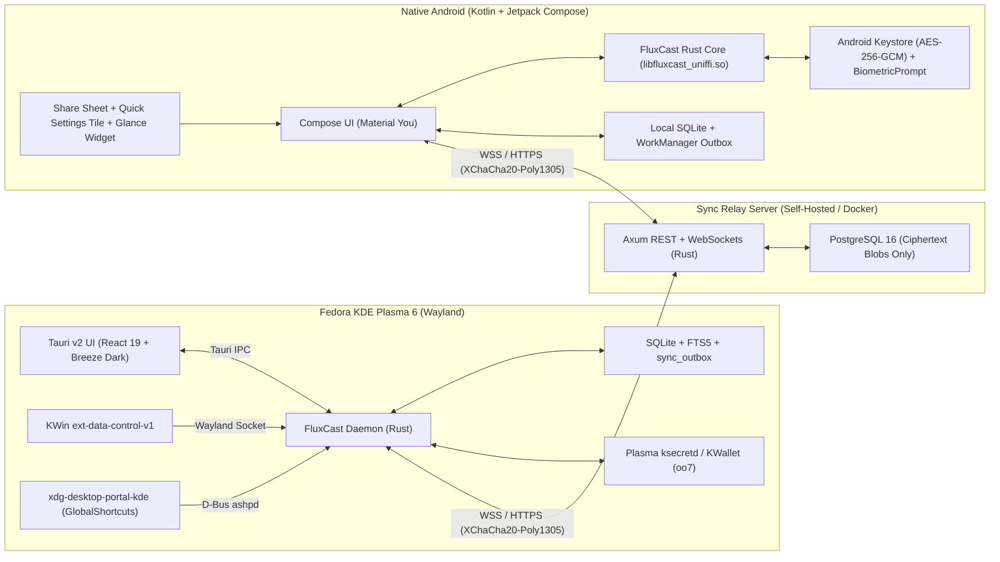

# FluxCast — System Architecture & Engineering Decisions (ADRs)

## 1. High-Level Topology

FluxCast is a **local-first, Zero-Knowledge E2EE** developer launcher, clipboard manager, and snippet vault designed natively for **Fedora Linux (KDE Plasma 6 / Wayland)** and **Android (Kotlin + Jetpack Compose)**, unified by a shared Rust core.

---

## 2. Crate & Module Boundaries

| Module | Language | Responsibility |
| :--- | :--- | :--- |
| `crates/fluxcast-core` | Rust | `nucleo-matcher` fuzzy catalog, `.desktop` + Flatpak + Git repository discovery, offline Dev Utilities, content classifier, template expansion (`{{clipboard}}`, `{{date}}`, `{{uuid}}`), and SQLite + FTS5 storage. |
| `crates/fluxcast-crypto` | Rust | `Argon2id` key derivation, `XChaCha20-Poly1305` AEAD encryption/decryption with 192-bit nonces and AAD binding, and blind `HMAC-SHA256` deduplication digests. |
| `crates/fluxcast-protocol` | Rust | Hybrid Logical Clock (`Hlc`) Last-Write-Wins conflict resolution, QR pairing payloads (120 s TTL), and REST/WebSocket wire types. |
| `crates/fluxcast-uniffi` | Rust | Mozilla UniFFI scaffolding exporting `fluxcast-crypto` and `fluxcast-protocol` to Kotlin/JNA with 16 KB ELF page alignment. |
| `apps/desktop` | Rust + TypeScript | Tauri v2 desktop app, KWin `ext-data-control-v1` Wayland daemon, `xdg-desktop-portal` GlobalShortcuts, `oo7` KWallet keyring, and UNIX socket CLI (`fluxcast toggle`). |
| `apps/sync-server` | Rust | Zero-Knowledge Axum relay server with PostgreSQL 16 storage, monotonic `seq` delta cursors, 120 s one-time pairing tokens, and per-user WebSocket broadcast hub. |
| `apps/android` | Kotlin | Jetpack Compose (Material You) app, Android Keystore + `BiometricPrompt`, CameraX + ML Kit QR pairing, WorkManager offline delta sync, Share Sheet, Quick Settings Tile, and Glance Home Widget. |

---

## 3. Architecture Decision Records (ADRs)

### ADR-001: Split CLI Binary (`fluxcast`) + Resident Tauri Daemon (`fluxcast-desktop`)
- **Context:** Tauri links against `libwebkit2gtk-4.1.so` and `libgtk-3.so`. Launching a full GTK/WebKit binary just to send a `"toggle\n"` command over a UNIX socket adds dynamic linker overhead (~30–80 ms).
- **Decision:** Package two binaries in `apps/desktop/src-tauri`: `fluxcast` (pure Rust `std`, linked only against `libc`) and `fluxcast-desktop` (the resident Tauri + Wayland daemon).
- **Outcome:** `fluxcast toggle` executes in **~2.2 ms (p50)** and **~2.9 ms (p95)**.

### ADR-002: Shared Rust E2EE Core via Mozilla UniFFI
- **Context:** Re-implementing `Argon2id`, `XChaCha20-Poly1305`, AAD construction, and HLC ordering separately in Rust and Kotlin invites subtle cryptographic incompatibilities.
- **Decision:** Write all cryptography and HLC rules once in `crates/fluxcast-crypto` and `crates/fluxcast-protocol`, and expose them to Android via `crates/fluxcast-uniffi`.
- **Outcome:** Mathematical guarantee of bit-for-bit interoperability between Fedora KDE and Android, verified in JVM unit tests via JNA.

### ADR-003: Monotonic Server Cursor (`seq`) + Hybrid Logical Clocks (HLC)
- **Context:** Devices frequently copy items or edit snippets while offline (e.g., laptop on a plane or phone on cellular).
- **Decision:** Each mutation is stamped with an HLC (`<wall_ms:015>-<logical:04x>-<node_id>`) and queued in `sync_outbox`. The relay server assigns a monotonic `seq` cursor on accept and rejects stale writes whose HLC is older than the stored record.
- **Outcome:** Deterministic Last-Write-Wins convergence without full CRDT overhead or server-side plaintext inspection.
