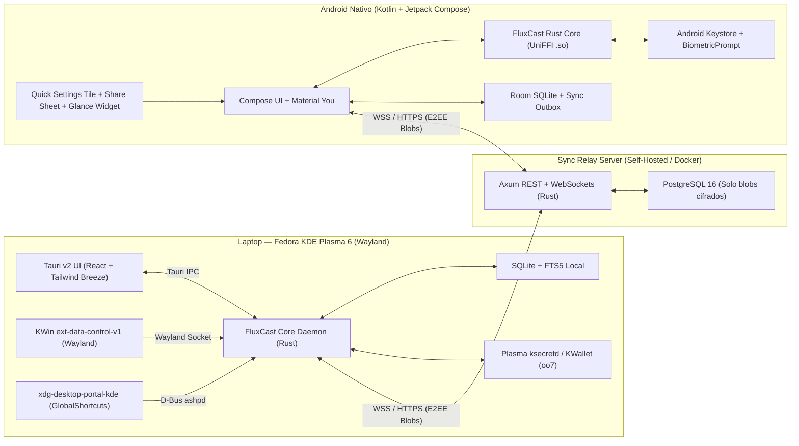

# Plan de Ingeniería — FluxCast (Fedora KDE Plasma 6 + Android Nativo)

> [!NOTE]
> **Nombre del proyecto:** **FluxCast**
> **Plataformas objetivo:** **Fedora Linux (KDE Plasma 6 / Wayland)** + **Android Nativo** + **Servidor Sync Self-Hosted (Docker)**
> **Alternativa Open-Source / Local-First a:** **Raycast Pro** (~\$10 USD/mes, sin Linux ni Android) y **Paste** (~\$30 USD/año, solo Apple).

---

## 1. Visión y Por Qué Este Stack Es el Mejor para Fedora KDE + Android

Elegimos el **mejor lenguaje nativo para cada plataforma**, unificados por un **núcleo compartido en Rust**:

1. **Fedora KDE Plasma 6 (Wayland) es ideal para este proyecto:** A diferencia de GNOME/Mutter, **KWin en Plasma 6** implementa de forma nativa los estándares modernos de Wayland:
    - **`ext-data-control-v1`** (monitoreo seguro del portapapeles en segundo plano sin hacks ni extensiones del shell).
    - **`org.freedesktop.portal.GlobalShortcuts`** (`xdg-desktop-portal-kde`, atajos globales nativos con diálogo de permisos del sistema).
    - **Freedesktop Secret Service (`ksecretd` / KWallet)** para guardar llaves cifradas del sistema.
2. **Android 100 % Nativo (Kotlin + Jetpack Compose):** Demuestra dominio real del ecosistema Android moderno (_Material You_, _Quick Settings Tile_, _Share Sheet_, _Glance Home Widget_, _Room_, _WorkManager_ y _Android Keystore + BiometricPrompt_).
3. **Núcleo compartido en Rust + Mozilla UniFFI:** La criptografía **E2EE (`Argon2id + XChaCha20-Poly1305`)**, la lógica de _Hybrid Logical Clocks_ y el motor de plantillas se escriben **una sola vez en Rust** y se compilan tanto para Fedora como para Android (`.so` vía `cargo-ndk` + bindings seguros de Kotlin generados por **UniFFI**). Cero código criptográfico duplicado y garantía matemática de interoperabilidad.

---

## 2. Arquitectura General del Sistema



---

## 3. Integración Nativa con Fedora KDE Plasma 6 (Wayland)

> [!IMPORTANT]
> Estas integraciones usan APIs oficiales de Plasma 6 / Wayland y evitan dependencias obsoletas de X11.

### A. Monitoreo de Portapapeles en KWin (`ext-data-control-v1`)

- Se diseña un `trait ClipboardProvider` en Rust cuya implementación principal (`WaylandDataControlProvider`) se conecta al compositor **KWin** mediante el protocolo estándar **`ext-data-control-v1`** (con fallback automático a `zwlr_data_control_manager_v1` para otros compositores Wayland y a X11 si fuera necesario).
- **Respeto nativo a contraseñas de KDE/Klipper:** Si la oferta MIME incluye `x-kde-passwordManagerHint` con valor `secret` (estándar usado por KeePassXC, Bitwarden, 1Password y Plasma), el daemon **ignora completamente** la copia y jamás la persiste ni la sincroniza.
- **Coexistencia limpia con Klipper:** FluxCast puede convivir con Klipper o actuar como tu historial principal sin robar el foco de las ventanas.

### B. Atajo Global Nativo (`Alt+Space` / `Meta+Space`)

- **Vía principal (Portal KDE):** El daemon usa el crate `ashpd` para registrar la acción `toggle_launcher` en **`org.freedesktop.portal.GlobalShortcuts`**. Plasma 6 muestra el diálogo oficial de autorización y te deja reasignar el atajo desde _Preferencias del Sistema → Accesos rápidos_.
- **Vía secundaria instantánea (UNIX Socket):** El daemon escucha en `$XDG_RUNTIME_DIR/fluxcast.sock`. El comando `fluxcast toggle` alterna la ventana en <5 ms (útil para scripts o atajos personalizados de KWin).

### C. Almacenamiento de Llaves (`ksecretd` / KWallet)

- Plasma 6 expone la API estándar **Freedesktop Secret Service** (`org.freedesktop.secrets`) mediante `ksecretd`.
- El daemon de Rust utiliza el crate **`oo7`** para guardar la _Master Key_ cifrada dentro de tu cartera de KDE sin archivos planos en disco.

### D. Empaquetado y Servicio en Fedora

- Servicio de usuario `systemd --user` (`fluxcast.service`) para que el daemon arranque con tu sesión de Plasma.
- Empaquetado oficial en **`.rpm`** (nativo para `dnf` en Fedora) y **`AppImage`** mediante Tauri Bundler.

---

## 4. Modelo de Seguridad (Zero-Knowledge E2EE)

```mermaid
sequenceDiagram
    participant D as Fedora KDE Daemon (Rust)
    participant S as Sync Relay Server (Zero-Knowledge)
    participant A as Android App (Kotlin + UniFFI Rust)

    Note over D,A: Ambos comparten la Master Key (Argon2id) vinculada por QR efímero
    D->>D: Detecta copia via ext-data-control-v1
    D->>D: Genera nonce (192-bit) y cifra con XChaCha20-Poly1305
    D->>D: Calcula HMAC-SHA256 ciego para deduplicación
    D->>S: WSS push { entity_id, hlc_ts, dedup_hmac, nonce, ciphertext }
    Note over S: Guarda solo bytes cifrados; nunca conoce el texto plano ni la llave
    S-->>A: WSS broadcast { entity_id, hlc_ts, dedup_hmac, nonce, ciphertext }
    A->>A: Descifra en Rust via UniFFI -> Guarda en Room SQLite
```

- **Derivación de llave (KDF):** `Argon2id` (parámetros OWASP, `salt` de 16 bytes único por cuenta).
- **Cifrado autenticado (AEAD):** `XChaCha20-Poly1305` (nonces aleatorios de 24 bytes seguros frente a colisiones).
- **Mismo código criptográfico en ambos extremos:** Tanto Fedora como Android ejecutan exactamente `crates/fluxcast-crypto` (en Android vía UniFFI `.so`), eliminando divergencias de implementación.
- **Emparejamiento por QR:** Fedora genera un QR temporal (expira en 120 s) con la URL del servidor, un token de registro de un solo uso y la llave simétrica protegida; Android lo escanea con **CameraX + ML Kit** y queda vinculado al instante.

---

## 5. Stack Tecnológico y Lenguajes

| Capa                     | Lenguaje        | Frameworks / Librerías Clave                                                                                                                                                                  | Por Qué Es la Mejor Opción                                                                                                                                     |
| :----------------------- | :-------------- | :-------------------------------------------------------------------------------------------------------------------------------------------------------------------------------------------- | :------------------------------------------------------------------------------------------------------------------------------------------------------------- |
| **Shared Core & Crypto** | **Rust**        | `chacha20poly1305`, `argon2`, `hmac`, `uuid` (v7), `serde`, `uniffi`                                                                                                                          | Seguridad de memoria, velocidad nativa y compilación compartida para Fedora, Sync Server y Android (vía UniFFI).                                               |
| **Fedora Daemon & Core** | **Rust**        | `tokio`, `rusqlite` (FTS5), `nucleo-matcher`, `wayland-client`, `ashpd`, `oo7`                                                                                                                | Integración directa con Wayland (`ext-data-control-v1`), `xdg-desktop-portal-kde` y `ksecretd` con <35 MB de RAM.                                              |
| **Fedora Desktop UI**    | **TypeScript**  | **Tauri v2**, React 19, Tailwind CSS v4, Zustand, `lucide-react`                                                                                                                              | Binario ligero (~12–15 MB vs ~150 MB de Electron), interfaz ultra fluida con estética **KDE Breeze Dark** y atajos 100 % teclado.                              |
| **App Android Nativa**   | **Kotlin**      | **Jetpack Compose**, Material 3 (Material You), **Room**, **Hilt**, **WorkManager**, **OkHttp** (WebSockets), **Glance** (Widgets), **CameraX + ML Kit**, `BiometricPrompt`, **UniFFI + JNA** | Estándar profesional para desarrollo Android; acceso total a _Share Sheet_, _Quick Settings Tile_, _Home Widget_ y _Android Keystore_ sin capas puente lentas. |
| **Sync Relay Server**    | **Rust**        | **Axum**, `tokio-tungstenite`, `sqlx`, PostgreSQL 16, Docker Compose                                                                                                                          | Comparte `fluxcast-protocol` con el cliente, latencia mínima en WebSockets y despliegue en 1 comando con Docker/Podman.                                        |
| **CI/CD & Packaging**    | **YAML / Bash** | Cargo Workspace, Gradle Kotlin DSL, `cargo-ndk`, GitHub Actions, `.rpm` & `.apk`                                                                                                              | Compilación automatizada de binarios `.rpm` (Fedora) y `.apk` (Android con alineación de páginas de 16 KB en NDK r27+).                                        |

---

## 6. Catálogo Completo de Funcionalidades

### A. Launcher en Fedora KDE Plasma (Estilo Raycast)

- **Búsqueda difusa instantánea (<15 ms):** Motor `nucleo-matcher` en Rust.
- **Lanzador de apps:** Indexa `.desktop` de `/usr/share/applications`, `~/.local/share/applications` y Flatpaks (`/var/lib/flatpak/exports/share/applications`).
- **Buscador de proyectos Git:** Escanea directorios configurados (ej. `~/Projects`, `~/Dev`) y abre el proyecto con un atajo en **VS Code**, **Konsole**, **Neovim** o **Dolphin**.
- **Dev Utilities offline integradas:**
    - Calculadora rápida (`(1920 * 0.75) + 48`).
    - Conversor `hex / bin / dec`, `Unix timestamp ↔ ISO-8601`, `Base64 encode/decode`, generador `UUID v4/v7` y decodificador local de `JWT`.
- **Acciones rápidas de Plasma:** Bloquear sesión (`loginctl lock-session`), suspender, copiar IP local/Tailscale y alternar modo pausa del portapapeles.

### B. Gestor de Portapapeles Inteligente

- Historial persistente con búsqueda _Full-Text_ (`SQLite FTS5`).
- **Clasificador automático:** Detecta `JSON` (con _pretty-print_), `URL`, `código` (heurística de lenguaje), `color HEX/RGB` (con swatch visual), `JWT` y texto plano.
- **Fijar favoritos (`Pin`)**, eliminación individual o limpieza rápida, y pegado limpio sin formato (`Shift+Enter`).
- **Filtros de privacidad:** Ignora contraseñas (`x-kde-passwordManagerHint=secret`) + _Modo Incógnito / Pausa_ (5 min, 15 min o manual).

### C. Bóveda de Snippets para Programadores

- Organización por etiquetas (`git`, `docker`, `fedora`, `sql`, `kotlin`, `rust`).
- **Plantillas con variables dinámicas:** `{{clipboard}}`, `{{date:YYYY-MM-DD}}`, `{{uuid}}`.
- **Alias / Keywords:** Invoca `!dprune` o `!klog` directo desde el launcher.
- Ranking inteligente por frecuencia de uso (_frecency_).

### D. App Móvil Android Nativa (Superpoderes Android)

- **Feed en tiempo real:** Ve inmediatamente lo último que copiaste en Fedora y cópialo al portapapeles de Android con un toque.
- **Enviar a Fedora:** Escribe o pega texto/código y envíalo directo al portapapeles de tu laptop con KDE.
- **Android Share Sheet (`ACTION_SEND`):** Desde Chrome, GitHub, YouTube o WhatsApp, pulsa _Compartir → FluxCast_ y el enlace llega al instante al portapapeles de Fedora.
- **Quick Settings Tile (Panel de ajustes rápidos):** Baja la barra de notificaciones de Android y toca el botón de FluxCast para enviar lo que tengas copiado en el celular hacia Fedora sin abrir la app.
- **Home Screen Widget (Jetpack Glance):** Consulta tu último ítem sincronizado o copia tus snippets favoritos desde la pantalla de inicio.
- **Seguridad nativa:** Desbloqueo con **BiometricPrompt** (huella/rostro), llave maestra en **Android Keystore** y emparejamiento por QR (**CameraX**).

---

## 7. Modelo de Datos y Protocolo de Sincronización

### Esquema SQLite Local (Fedora `rusqlite` y Android `Room`)

```sql
CREATE TABLE clipboard_items (
    id TEXT PRIMARY KEY,              -- UUIDv7 (ordenable cronológicamente)
    content_type TEXT NOT NULL,       -- 'text' | 'code' | 'json' | 'url' | 'color' | 'jwt'
    content TEXT NOT NULL,
    preview TEXT NOT NULL,            -- Primeros 240 caracteres
    dedup_hmac TEXT NOT NULL,         -- HMAC ciego para evitar duplicados
    source_device_id TEXT NOT NULL,
    is_pinned INTEGER NOT NULL DEFAULT 0,
    hlc_timestamp TEXT NOT NULL,      -- Hybrid Logical Clock (resolución LWW)
    created_at INTEGER NOT NULL,
    updated_at INTEGER NOT NULL,
    deleted_at INTEGER                -- Tombstone para propagar borrados
);

CREATE VIRTUAL TABLE clipboard_fts USING fts5(
    content,
    content='clipboard_items',
    content_rowid='rowid'
);

CREATE TABLE snippets (
    id TEXT PRIMARY KEY,              -- UUIDv7
    title TEXT NOT NULL,
    keyword TEXT UNIQUE,              -- Ej: '!dclean'
    body TEXT NOT NULL,               -- Soporta {{clipboard}}, {{date}}, {{uuid}}
    language TEXT NOT NULL DEFAULT 'plaintext',
    tags_json TEXT NOT NULL DEFAULT '[]',
    use_count INTEGER NOT NULL DEFAULT 0,
    hlc_timestamp TEXT NOT NULL,
    created_at INTEGER NOT NULL,
    updated_at INTEGER NOT NULL,
    deleted_at INTEGER
);

CREATE TABLE sync_outbox (
    entity_id TEXT PRIMARY KEY,
    entity_kind INTEGER NOT NULL,     -- 1 = clipboard, 2 = snippet
    queued_at INTEGER NOT NULL
);
```

### Esquema PostgreSQL (Sync Relay Server — Zero-Knowledge)

```sql
CREATE TABLE sync_blobs (
    seq BIGSERIAL PRIMARY KEY,        -- Cursor monotónico para delta sync
    user_id UUID NOT NULL,
    entity_id UUID NOT NULL,
    entity_kind SMALLINT NOT NULL,    -- 1 = clipboard, 2 = snippet
    device_id UUID NOT NULL,
    hlc_timestamp TEXT NOT NULL,
    dedup_hmac BYTEA,
    nonce BYTEA NOT NULL,             -- 24 bytes (XChaCha20-Poly1305)
    ciphertext BYTEA NOT NULL,        -- Payload JSON cifrado
    is_deleted BOOLEAN NOT NULL DEFAULT FALSE,
    created_at TIMESTAMPTZ NOT NULL DEFAULT NOW(),
    UNIQUE (user_id, entity_id)
);

CREATE INDEX idx_sync_blobs_user_seq ON sync_blobs (user_id, seq);
```

### Protocolo Delta Sync (Offline-First)

1. Toda mutación se guarda primero localmente en SQLite/Room y se encola en `sync_outbox`.
2. Al reconectar:
    - **Pull:** `GET /api/v1/sync/pull?since_seq=<cursor>` descarga deltas cifrados, los descifra en Rust (directo en Fedora, vía UniFFI en Android) y resuelve conflictos con **Last-Write-Wins** sobre `hlc_timestamp`.
    - **Push:** Sube `sync_outbox` cifrado y limpia los confirmados.
    - **Tiempo Real:** Mantiene conexión WebSocket (`/api/v1/ws`) para propagación en <150 ms.

---

## 8. Estructura de Carpetas del Monorepo

```text
fluxcast/
├── .github/
│   └── workflows/
│       ├── ci-rust.yml                 # cargo fmt, clippy, test (workspace completo)
│       ├── ci-desktop.yml              # typecheck + build Tauri (.rpm / AppImage)
│       └── ci-android.yml              # cargo-ndk + UniFFI + Gradle test & APK build
├── Cargo.toml                          # Rust Workspace raíz
├── docker-compose.yml                  # Sync Relay Server + PostgreSQL 16
├── docs/
│   ├── architecture.md                 # ADRs y diagramas del sistema
│   ├── crypto-spec.md                  # Especificación E2EE (Argon2id + XChaCha20)
│   └── kde-wayland.md                  # Integración con KWin, Portals y ksecretd
│
├── crates/                             # Núcleo Rust compartido
│   ├── fluxcast-protocol/              # Modelos de sync, HLC, mensajes HTTP/WS
│   ├── fluxcast-crypto/                # Argon2id + XChaCha20-Poly1305 + HMAC
│   ├── fluxcast-core/                  # SQLite + FTS5, nucleo fuzzy, dev utils, templates
│   └── fluxcast-uniffi/                # Bindings UniFFI exportados a Kotlin (Android)
│
├── apps/
│   ├── desktop/                        # App Fedora KDE Plasma (Tauri v2 + React)
│   │   ├── src/                        # UI React + Tailwind (tema KDE Breeze Dark)
│   │   │   ├── components/
│   │   │   │   ├── CommandBar.tsx      # Launcher con navegación 100 % teclado
│   │   │   │   ├── ClipboardView.tsx   # Historial + preview JSON/Código/Color
│   │   │   │   ├── SnippetsView.tsx    # Gestión de snippets y plantillas
│   │   │   │   └── PairingModal.tsx    # Generador QR para vincular Android
│   │   │   ├── stores/                 # Estado Zustand
│   │   │   └── lib/                    # Invocaciones Tauri IPC
│   │   └── src-tauri/                  # Backend Rust Tauri + Daemon KDE Wayland
│   │       ├── src/
│   │       │   ├── main.rs
│   │       │   ├── ipc_socket.rs       # UNIX socket para `fluxcast toggle`
│   │       │   ├── shortcuts.rs        # xdg-desktop-portal GlobalShortcuts (ashpd)
│   │       │   ├── keyring.rs          # Plasma ksecretd / KWallet (oo7)
│   │       │   ├── launcher/           # Indexador .desktop, Flatpak, Git, Dev Utils
│   │       │   ├── clipboard/
│   │       │   │   ├── mod.rs          # trait ClipboardProvider + filtro contraseñas
│   │       │   │   ├── wayland.rs      # ext-data-control-v1 / wlr-data-control (KWin)
│   │       │   │   └── x11.rs          # Fallback X11
│   │       │   └── sync_worker.rs      # Cliente WebSocket + delta sync
│   │       ├── tauri.conf.json         # Config bundle .rpm / AppImage
│   │       └── Cargo.toml
│   │
│   ├── android/                        # App Android Nativa (Kotlin + Jetpack Compose)
│   │   ├── app/
│   │   │   ├── build.gradle.kts        # Dependencias Compose, Room, Hilt, JNA, Glance
│   │   │   └── src/main/
│   │   │       ├── jniLibs/            # Librerías .so compiladas por cargo-ndk
│   │   │       └── java/dev/fluxcast/
│   │   │           ├── FluxCastApp.kt
│   │   │           ├── core/           # Bindings Kotlin generados por UniFFI
│   │   │           ├── data/           # Room DB, DAOs, SyncRepository, WebSocket
│   │   │           ├── security/       # KeystoreManager + BiometricPrompt
│   │   │           ├── ui/             # Pantallas Compose (Clipboard, Snippets, Send, QR)
│   │   │           ├── share/          # ShareReceiverActivity (ACTION_SEND)
│   │   │           ├── tile/           # SendClipboardTileService (Quick Settings)
│   │   │           └── widget/         # FluxCastGlanceWidget (Home Screen)
│   │   ├── build.gradle.kts
│   │   └── settings.gradle.kts
│   │
│   └── sync-server/                    # Servidor Zero-Knowledge (Rust + Axum)
│       ├── migrations/                 # Migraciones SQLx para PostgreSQL
│       ├── src/
│       │   ├── main.rs
│       │   ├── auth.rs                 # JWT, refresh tokens y pairing tokens efímeros
│       │   ├── routes/                 # /sync/pull, /sync/push, /devices, /health
│       │   └── ws.rs                   # Hub WebSocket en tiempo real por usuario
│       ├── Dockerfile
│       └── Cargo.toml
│
├── scripts/
│   ├── build-android-rust.sh           # Compila fluxcast-uniffi con cargo-ndk y genera Kotlin
│   ├── install-fedora-kde.sh           # Instala servicio systemd --user y configura entorno
│   └── fluxcast.service                # Unidad systemd --user para Fedora
├── README.md
└── LICENSE                             # MIT
```

---

## 9. Plan de Implementación por Etapas (8–10 Semanas)

### Etapa 0 — Entorno en Fedora KDE Plasma y Monorepo _(Días 1–3)_

**Estado:** implementada y verificada localmente en Fedora KDE. La [guía de desarrollo](README.md) incluye la configuración reproducible y los comandos de prueba.

- **Tareas:**
    1. Instalar dependencias en Fedora KDE:
        ```bash
        sudo dnf install webkit2gtk4.1-devel openssl-devel curl wget file \
          libappindicator-gtk3-devel librsvg2-devel sqlite-devel \
          wl-clipboard pkgconf-pkg-config gcc-c++ rpm-build patchelf fuse fuse-libs podman-compose
        ```
        _(En Fedora 45+, instala Temurin JDK 17 para Gradle ya que `java-17-openjdk-devel` ya no está en los repositorios estándar.)_
    2. Instalar `rustup`, `pnpm`, `cargo-ndk`, targets Android (`aarch64-linux-android`, `x86_64-linux-android`), Android Studio (SDK + NDK r27+) y `podman-compose` o `docker`.
    3. Crear la estructura del monorepo (Cargo Workspace + Tauri + Gradle Android + GitHub Actions CI).
- **Entregable:** `cargo test --workspace` y `./gradlew testDebugUnitTest` pasando en verde.

### Etapa 1 — Launcher Nativo en Fedora KDE Plasma _(Semanas 1–2)_

**Estado:** implementada y verificada localmente en Fedora KDE Plasma (KWin Wayland + `xdg-desktop-portal-kde` + UNIX socket).

- **Tareas:**
    1. Implementar `crates/fluxcast-core`: motor fuzzy `nucleo-matcher`, indexador de `.desktop` + Flatpak, escáner de repositorios Git, _Dev Utilities_ (calculadora, Base64, UUID, timestamp, JWT) y acciones rápidas de Plasma.
    2. Construir la ventana flotante sin bordes en Tauri v2 (React + Tailwind con paleta Breeze Dark) navegable al 100 % con teclado.
    3. Implementar el atajo global nativo en Plasma 6 usando **`ashpd` (`org.freedesktop.portal.GlobalShortcuts`)** + respaldo instantáneo por UNIX Socket (`fluxcast toggle`).
- **Entregable:** Invocas FluxCast con `Alt+Space` en Fedora KDE, buscas un proyecto Git o app y lo abres en <15 ms.

### Etapa 2 — Daemon de Portapapeles KWin Wayland + Snippets _(Semanas 3–4)_

- **Tareas:**
    1. Implementar SQLite + FTS5 en `fluxcast-core` para `clipboard_items` y `snippets`.
    2. Construir `WaylandDataControlProvider` sobre **`ext-data-control-v1`** (KWin) con filtrado estricto de `x-kde-passwordManagerHint=secret` y _Modo Pausa_.
    3. Añadir clasificador automático (JSON, URL, código, color HEX) y vista de portapapeles con vista previa y botón de _Pin_.
    4. Construir CRUD de Snippets + motor de expansión (`{{clipboard}}`, `{{date}}`, `{{uuid}}`) y ranking por frecuencia.
- **Entregable:** Herramienta 100 % utilizable a diario en tu Fedora KDE Plasma (offline-first).

### Etapa 3 — Criptografía E2EE, UniFFI y Sync Relay Server _(Semanas 5–6)_

- **Tareas:**
    1. Implementar `crates/fluxcast-crypto` (`Argon2id` + `XChaCha20-Poly1305` + `HMAC-SHA256`) y `crates/fluxcast-uniffi` con macros `#[uniffi::export]`.
    2. Configurar `scripts/build-android-rust.sh` usando `cargo-ndk` (con soporte de alineación de 16 KB) y `uniffi-bindgen` para generar bindings Kotlin probados.
    3. Construir `apps/sync-server` (Axum + WebSockets + PostgreSQL + `docker-compose.yml`) con autenticación JWT y tokens de emparejamiento QR efímeros.
    4. Conectar `sync_worker.rs` en Fedora guardando la _Master Key_ en **KWallet / `ksecretd`** mediante `oo7`, y mostrar el QR de vinculación en la UI de escritorio.
- **Entregable:** Servidor corriendo con `docker compose up`, Fedora sincronizando blobs cifrados en vivo y bindings Kotlin listos.

### Etapa 4 — App Android Nativa (Kotlin + Jetpack Compose) _(Semanas 7–8)_

- **Tareas:**
    1. Configurar el proyecto Android con Jetpack Compose (Material You), Hilt, Room DB y la librería `.so` generada por UniFFI (`fluxcast-uniffi`).
    2. Implementar **Android Keystore + `BiometricPrompt`** y escáner QR (**CameraX + ML Kit**) para vincular con Fedora en un paso.
    3. Implementar cliente WebSocket (OkHttp) + delta sync offline con **WorkManager**.
    4. Construir pantallas Compose: **Clipboard Feed**, **Snippets Offline**, **Enviar a Fedora** y **Ajustes**.
    5. Agregar las 3 funciones nativas estrella de Android:
        - **Share Sheet (`ACTION_SEND`)** para mandar enlaces/texto desde cualquier app directo a Fedora.
        - **Quick Settings Tile** para enviar el portapapeles actual a Fedora con 1 toque.
        - **Glance Home Widget** con tu último ítem sincronizado y accesos rápidos.
- **Entregable:** Copias un comando o token en Fedora KDE y aparece al instante en Android; compartes una URL desde Chrome Android y queda lista para `Ctrl+V` en Fedora.

### Etapa 5 — Empaquetado `.rpm`, Pruebas y Lanzamiento en GitHub _(Semanas 9–10)_

- **Tareas:**
    1. Crear `scripts/fluxcast.service` (`systemd --user`) y `scripts/install-fedora-kde.sh`.
    2. Configurar GitHub Actions para generar releases automáticos con paquete **`.rpm`** (Fedora), **`AppImage`** y **`.apk`** firmado (Android).
    3. Escribir tests de integración (resolución de conflictos offline HLC, filtrado de contraseñas, pruebas instrumentadas en Android de UniFFI E2EE).
    4. Medir métricas reales (RAM en Fedora, latencia de búsqueda y latencia de sync) y grabar 2–3 GIFs/videos cortos para el `README.md`.
- **Entregable:** Release `v1.0.0` publicada en GitHub con binarios descargables y documentación profesional en inglés.
